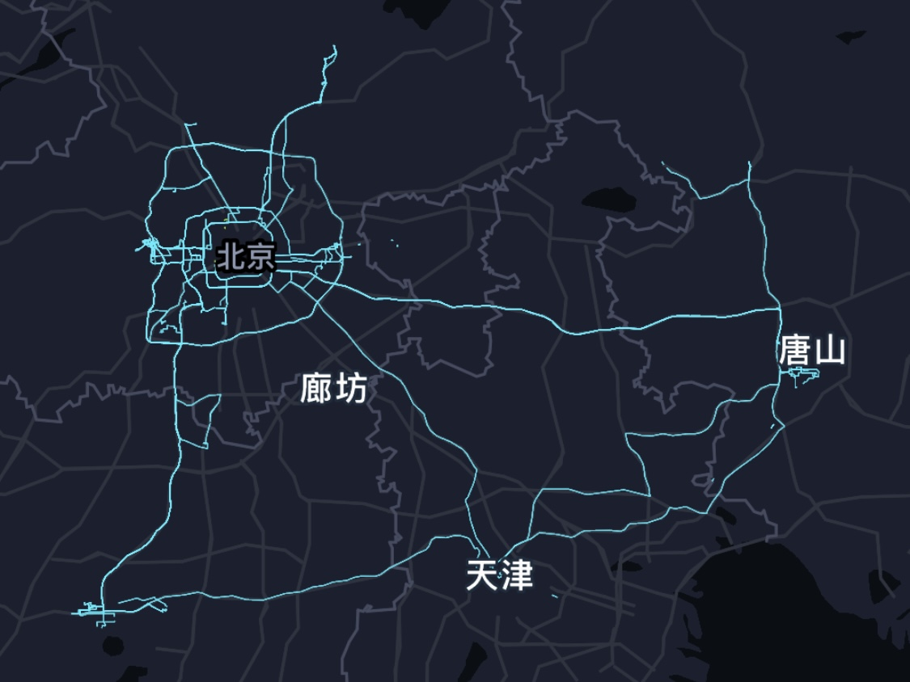
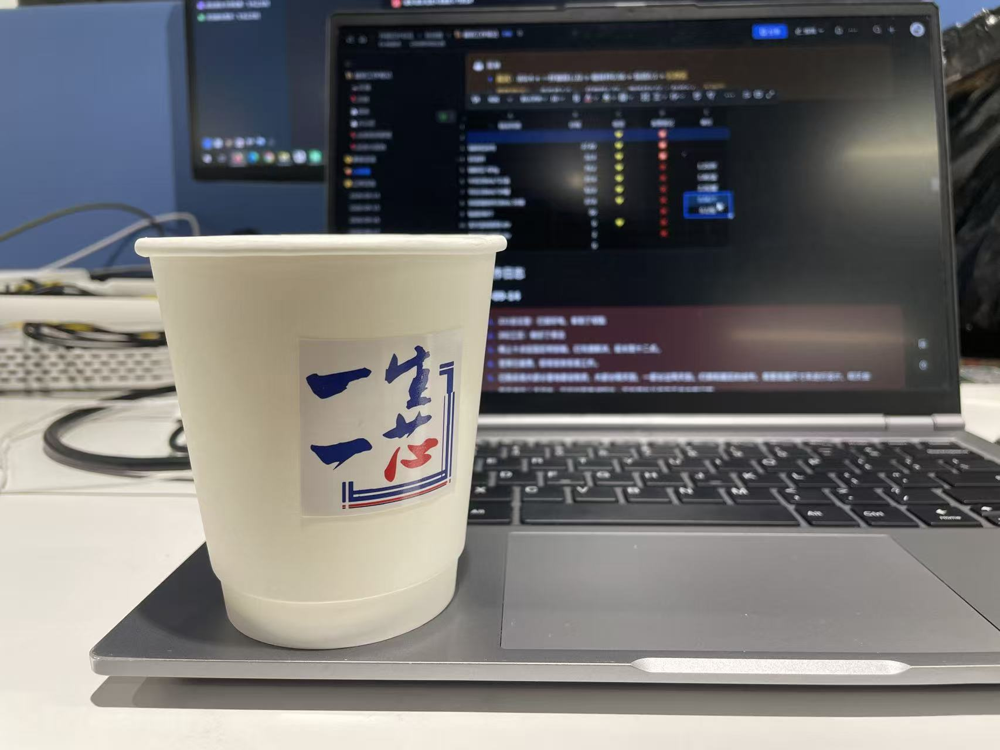
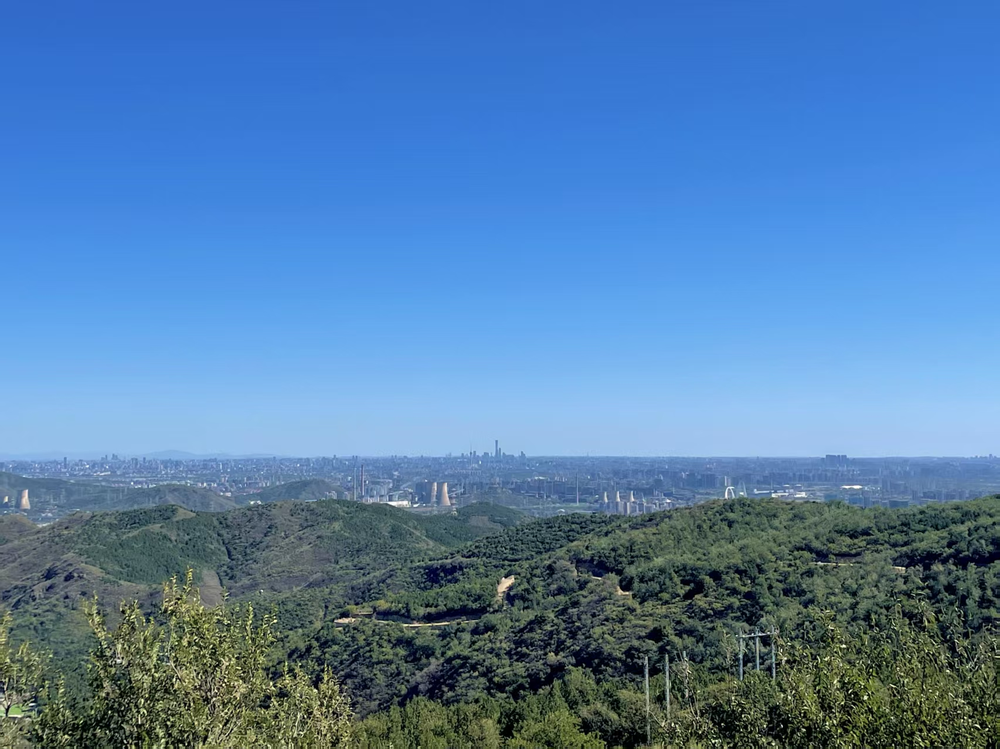
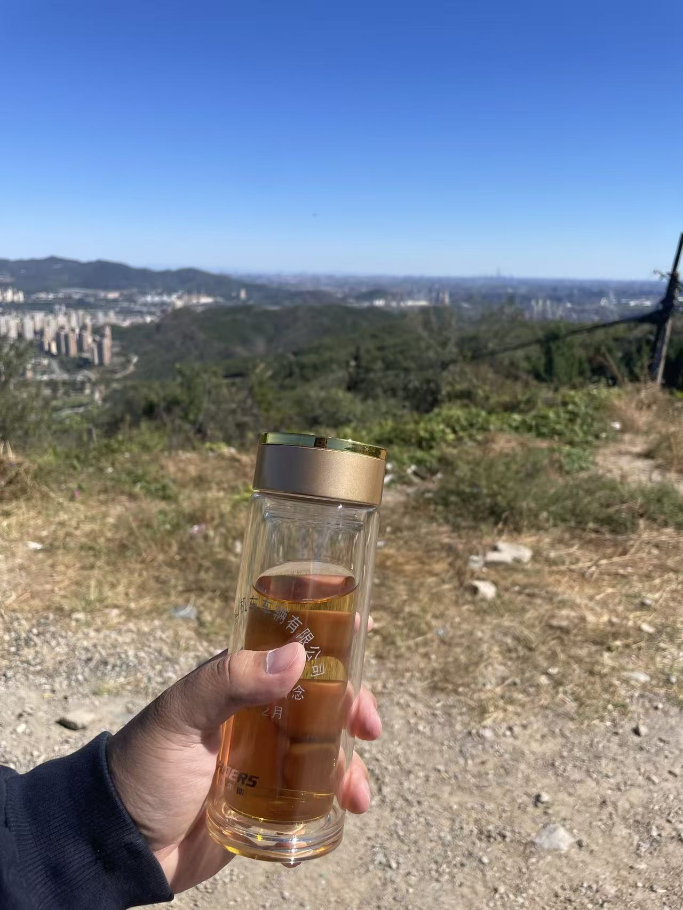
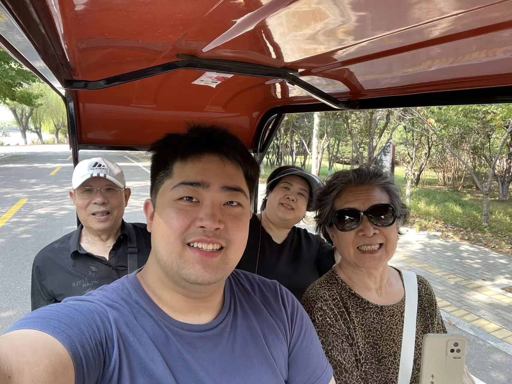
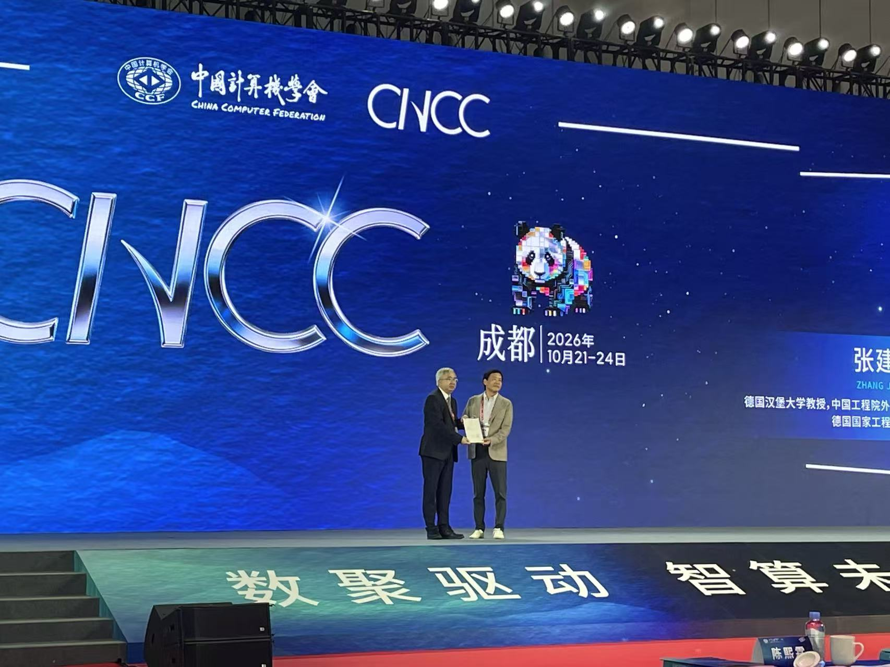
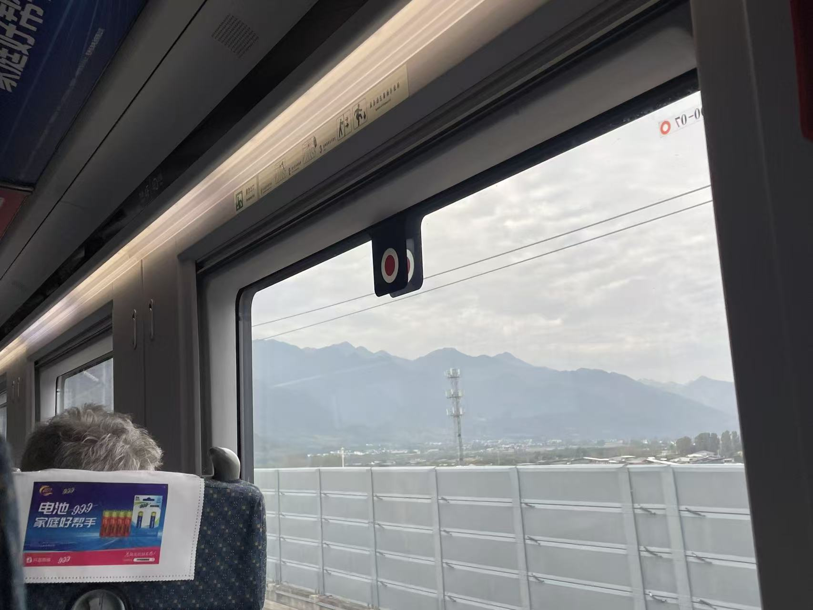
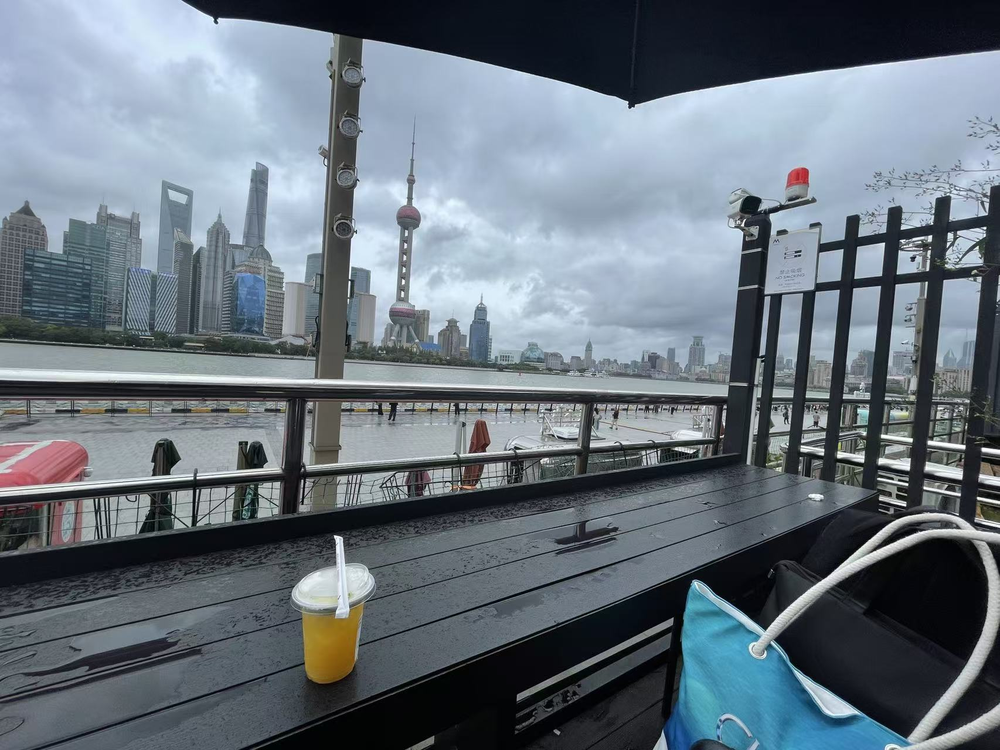
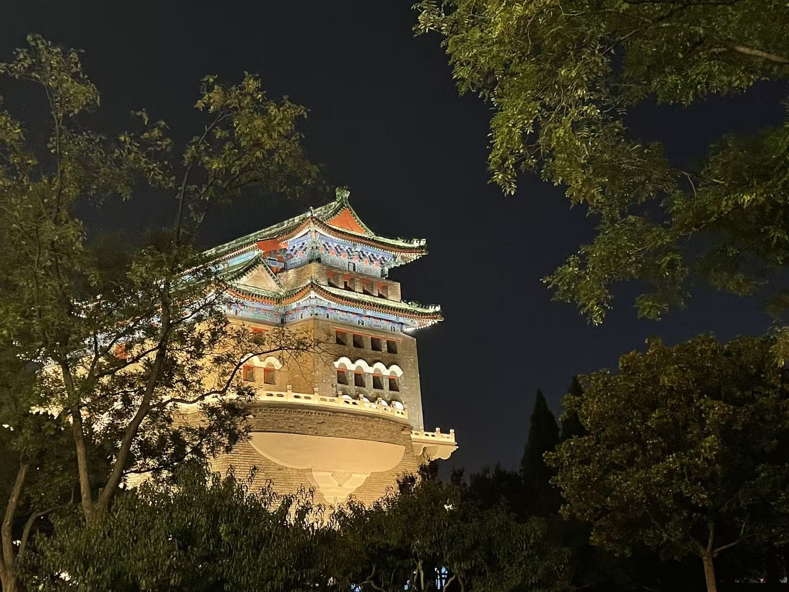

# 第38-44周总结

!!! info "0914-1031"
    
!!! tip "My Songs"

    <iframe frameborder="yes" border="100" marginwidth="4" marginheight="0" width=333 height=86 src="//music.163.com/outchain/player?type=2&id=3386983734&auto=0&height=66"></iframe>

    - 唱山有百转千折 我一路跋涉 何惧万里路远 且翻它个一座座~
    - 形势明朗了，心情也开阔了😄

!!! danger "主线"

😮哎呀，一下子过去了7周，时间过得好快，事情也做了好多😈。我想，从本次周报开始，采用散文笔记的方式来呈现给大家吧。毕竟我也不知道以后是否能够周更了QAQ，但愿吧~😏

行百里路🚗，读万卷书📖。发现自己的出行需求是刚需后，我迎来了我人生第一辆小车——粉色小海鸥。尽管咱小时候上学也没少坐汽车（桑塔纳/派力奥/3008），但是属于咱自己家购买的，还是第一辆，也是具有挺大的意义了😋。从 9 月 21 日交车，到现在我已经在京津雄唐纵横了 5456 公里了：去雄安的工作通勤，回唐山家里看看，去天津瞎溜达散散心，跑湖里休闲自习，去通州看看亲戚……我的行踪无处不在，已经织成了一张网。

  
  
<em>京津雄唐的足迹</em>

说实话，我也没想到我的通勤需求一下子几乎全部迁移到了汽车上，也没想到我的需求量如此之大😮——好吧，大概是回家方便了许多，回家次数也是越来越多了🏠，真不错。当然，尽管小海鸥的实用性（电量足够、电机也挺有力、经济性好、高速巡航+自动泊车）使我感受到科技带来的美好生活🌌，但是实实在在让老妈背了车贷🌚（但比租车便宜多了），倒也并不能够沾沾自喜，还是得努力进步，多快好省。

有了车之后，去基地的通勤就非常舒服了——门头沟到雄安，在京雄高速上定速巡航 80 km/h，只需要 2 小时。相对于 家里--北京西--雄安站/白洋淀--基地 要耗费 2.5-4 小时的情况，同样成本车快，同样时间车便宜。这不得不令我感叹，200km内的通勤，电车还是太超模了😈。

一直没有做周记的原因是在建设雄安基地🏗。历经两个月的时间，雄安基地的建设基本上告一段落了。实际上高速建设期在0914-0924这一段时间，后面的工作虽然重要，但不再密集。🎉总之，欢迎来了解[一生一芯雄安基地(不定期更新)](https://tqdy06h5fq.feishu.cn/docx/EMahdpXm9o0Rb9x3kpZcsMRZnFc)！

  
  
<em>雄安基地与ysyx咖啡</em>

!!! example "主线介绍差不多了，下面是杂谈环节~☕"

🍁北京的秋天大概是中秋后悄然到来的，它大概只停留了三周。14日的时候还骄阳似火，中午大太阳晒得人直冒汗☀；可到了撰文此刻，则又要穿上带绒的保暖衣了💨。我喜欢北京的秋天😉。有红红绿绿的叶子🍂，秋高气爽的天气🌤，暖阳照在身上并不酷热，而是一种自然的温暖。十一当天，我临时起意，开着小车爬山看全城风景⛰，没想到竟是国庆长假唯一的大晴天。

  
  
<em>于赵家洼俯瞰京城</em>

🍵在山上看景饮茶，的确是一件惬意的事情吧！

  
  
<em>看景饮茶</em>

刚提车的心情还是蛮激动的，于是带着姥姥姥爷去南湖转悠一圈儿，也算是一种城市散步嘞！我们在公园里租了一辆小电车，慢慢悠悠开着欣赏风景和温暖的秋风。

  
  
<em>南湖游览</em>

10 月 21 ~ 23 日，我去成都参加 CNCC 2026，没想到今年大会的主题几乎就是 AI 与 AI+ 。我对 AI 不算了解，听了几场主题报告之后，感到爆炸瘫坐（即“看到原子弹爆炸一样震撼，瘫坐在椅子上”的梗）。没想到 AI 已经发展到了这个地步（表情包）！比如了解到 “agent很难从零设计/制造pipeline” “a对memory的管理，对计算资源的管理……是制约ai前进的脚步” 等等内容。🚶‍尽管我采用大溜达理论，感兴趣什么就听什么，但还是收获颇丰。😮但是可惜了，早知道包老师24日在上午圆桌论坛，我就不早走了😭，怒亏1亿。

  
  
<em>CNCC现场</em>

去成都时，从西安转的车。西城高铁建成还没多久，我也体验上了。只感叹秦岭之于“南北方分界线”的意义，巍峨耸立，使人不得不感叹——蜀道难，难于上青天😮。到了成都，则感受到天府之国的温润随和。开会的几天都是淅淅沥沥的小雨，每每开完会返回酒店，来上那么一大碗芸豆蹄花汤，配上店家的蘸水，又香又暖🥰。另，西安与成都两个城市的地铁导视都做的非常好，使我这个第一次来的 GreenHand 也能非常顺利地乘坐与换乘（成都18号线速度太超模了，真牛）。

  
  
<em>秦岭小窥</em>

24日一早，我就从成都飞到了上海✈，体验了 300 km/h 的磁浮线后🚅，与智健相聚于黄浦江畔⛴。印院一别，也是有两年多没见面了，这次相聚非常开心。坐在黄浦江畔☔打着雨伞促膝长谈（好吧其实是侃大山呢），小雨给相聚添了一层惬意的氛围（好吧，打伞喝咖啡确实有点抽象😆）。

  
  
<em>浦江&咖啡店</em>

最近也开始运动了起来，我打算重新走一遍内城，用高德来记录一下足迹。前日开始溜达，没想到一开心，从阜成门直走到前门了，整整7km，1小时5km的配速，溜达完心情舒畅得嘞，真不赖。

  
  
<em>你爷爷我小~的时候🎵……啊咧咧，串台了，这是前门啦！</em>

这7周其实实在是太忙，我无法腾出什么时间来写整理我的思绪与足迹。也算是忙里偷闲，得空赶紧写一篇，不然不知道又要拖延到什么时候了。

!!! info "一些零散想法与感受"

- 要把遥远的当做虚拟的，要把身边的当做真实的。因为我观察不到具体的动作。
- 应当思考“稳定交付”的能力，因为技术人的技术变化也太大了，更不用说“办事能力”了
- “噪声”大会特别影响日常正常生活
- 治安优良的地方才宜居
- 我感受到我有多忙了：我能周六日拿出脑子继续学习就不容易了，剩下时间是真的一点也不想说话。
- 知道了某些“禁忌知识”之后，才发现某些人早已泯然众人，令人感叹
- 扩表——资产与精力的Tradeoff
    - 比如当前精力几乎占满，且时间有无法扩张性，则扩表就是置身于危险之地
    - 但是资产能通过投资与消费的方式对精力进行节省，对效率产生优化，那么就可以通过对工具的投资，对交通的消费来节省精力了。
    - 资产在一段时间有限，实际上扩表也受限，在资本市场上则有融资这样的风险较大的手段。
    - 还是不建议期货当现货的思维，去杠杆难坚持但是还是要坚持的。
- 还是太安逸了。想要务实一点，就得清楚自己的现实情况几斤几两。
- 不开车才是惬意啊~
    - 公共交通凸显了其最优秀的特点：速度快，成本低，不需要驾驶劳累，放松心情
    - 开车是高效的上班模式，公交地铁是随心的放松模式

!!! warning "好啦，到此结束，下周接着好好干！"

浩哈哈 于 2026 年 10 月 31 日 16:10